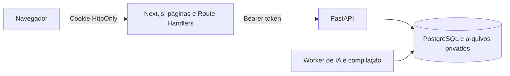

# Plano de implementação do front-end

## 1. Objetivo e escopo

Implementar a interface web do otimizador de currículos na pasta `front`, com **Next.js, TypeScript e Tailwind CSS**, login obrigatório para todas as páginas internas e layout mobile first. O usuário deve conseguir enviar um currículo, revisar o texto extraído, solicitar a otimização para uma vaga, conferir a proposta, editar o LaTeX, visualizar o PDF e baixar os arquivos.

Este documento complementa `plano.md` e `prompt.md`. Considera também os contratos implementados em `api/app/api/routes.py`, `api/app/presentation/schemas.py` e as regras documentadas em `api/README.md`, inspecionados em 20/10/2026. A pasta `front` ainda está vazia. As decisões abaixo são um plano de implementação, não funcionalidades já entregues.

### Regras de produto preservadas

- Interface e currículos em português do Brasil, com um template LaTeX.
- PDF com texto selecionável ou DOCX; OCR fora do MVP.
- Revisão obrigatória do texto extraído e consentimento explícito antes do envio à IA.
- Alterações, evidências e lacunas apresentadas separadamente; nenhuma promessa de aprovação em ATS.
- Cinco otimizações por mês civil em UTC, conforme configuração e resposta da API. Reservas e propostas aguardando revisão também entram no consumo; a interface não calcula a cota por conta própria.
- Prévia e exportação não consomem otimizações, mas estão sujeitas aos limites técnicos do servidor.
- Arquivos privados; dados salvos mantidos até exclusão solicitada; prévias temporárias.
- Uso acadêmico local, com Next.js, FastAPI e worker executados como processos separados no mesmo projeto.

Ficam fora do MVP: login social, recuperação de senha por e-mail, pagamento, administração, múltiplos templates, editor visual de currículo, colaboração simultânea e funcionamento offline. Não exibir controles que dependam desses recursos.

## 2. Stack e organização

| Camada | Escolha proposta | Responsabilidade |
| --- | --- | --- |
| Aplicação | Next.js com App Router e React | Rotas, renderização no servidor e endpoints de integração. |
| Linguagem | TypeScript em modo `strict` | Contratos explícitos e verificação de tipos. |
| Estilos | Tailwind CSS | Layout responsivo, tokens visuais e estados de interação. |
| Componentes | shadcn/ui sobre primitivas acessíveis | Botões, formulários, diálogos, abas e navegação; incorporar somente o necessário. |
| Formulários | React Hook Form + Zod | Validação local, mensagens por campo e estados de envio. |
| Dados no cliente | TanStack Query | Consultas, polling, invalidação e estados de requisição. |
| HTTP | `fetch` nativo encapsulado | Comunicação tipada com tratamento uniforme de erros. |
| Tipos da API | `openapi-typescript` | Gerar tipos a partir do OpenAPI do FastAPI; não editar tipos gerados manualmente. |
| Editor | CodeMirror 6 | Edição de LaTeX; carregamento sob demanda e alternativa em `textarea`. |
| PDF | React-PDF sobre PDF.js | Prévia com páginas e zoom; worker local e carregamento sob demanda. |
| Ícones | Lucide React | Ícones acompanhados de rótulos acessíveis. |
| Testes | Vitest + Testing Library + MSW | Regras da interface, componentes e respostas HTTP simuladas. |
| Fluxos reais | Playwright | Autenticação, jornada completa e verificação responsiva. |
| Qualidade | ESLint, TypeScript e Prettier | Verificação estática, consistência e formatação. |

Usar uma versão estável do Next.js compatível com as bibliotecas escolhidas e Tailwind CSS 4. Fixar versões no `package-lock.json` e documentar o Node.js LTS suportado pela versão selecionada. Validar editor, viewer e worker PDF em um protótipo técnico antes de fechar as dependências. Usar npm como gerenciador único do front.

Aplicar separação de responsabilidades, SOLID e DRY em módulos e adaptadores tipados, mantendo componentes React funcionais. Evitar replicar no front as camadas de persistência e as regras de negócio que já pertencem ao FastAPI.

### Estrutura proposta

```text
front/
  src/
    app/
      (public)/
        page.tsx
        login/page.tsx
        cadastro/page.tsx
      (private)/
        layout.tsx
        painel/page.tsx
        curriculos/page.tsx
        curriculos/novo/page.tsx
        curriculos/[id]/revisao/page.tsx
        curriculos/[id]/editor/page.tsx
        otimizacoes/[id]/page.tsx
        conta/page.tsx
      api/
        auth/                       # login, cadastro, sessão e logout
        backend/                    # rotas permitidas de integração com FastAPI
      layout.tsx
      globals.css
      not-found.tsx
    components/
      ui/
      layout/
    features/
      auth/
      curriculos/
      otimizacao/
      editor/
      uso/
    lib/
      server/                       # sessão e cliente FastAPI; módulos server-only
      http/                         # cliente do navegador e normalização de erros
      validation/
    generated/
      api.ts
    providers/
    proxy.ts                        # filtro inicial, sem substituir autorização
  tests/
    unit/
    integration/
    e2e/
  .env.example
  README.md
```

Os grupos `(public)` e `(private)` organizam arquivos e não fazem parte das URLs. O nome `(private)` não protege uma rota automaticamente. Adicionar `loading.tsx` e `error.tsx` nos segmentos que carregam dados. Manter componentes interativos pequenos; páginas e consultas iniciais ficam no servidor sempre que apropriado.

## 3. Integração com a API

O Next.js funcionará como uma camada fina de integração, chamada BFF: o navegador acessa o próprio domínio do Next.js; o servidor Next.js encaminha as operações permitidas ao FastAPI. A API existente continua responsável por usuários, autorização por proprietário, cota, armazenamento, IA e compilação. Esse uso de Route Handlers é suportado pelo [guia de Backend for Frontend do Next.js](https://nextjs.org/docs/app/guides/backend-for-frontend).



- Configurar `API_BASE_URL` somente no servidor, sem prefixo `NEXT_PUBLIC_`. No ambiente local, apontar para `http://localhost:8000`; em contêiner, usar o endereço interno correto.
- Manter a chave da OpenAI e o segredo JWT exclusivamente na API. O Next.js usa o token emitido pelo FastAPI, sem emitir identidades próprias.
- Server Components usam o cliente FastAPI no servidor diretamente, sem uma chamada HTTP ao próprio BFF. Componentes do navegador acessam `/api/...`.
- Implementar uma lista explícita de métodos e caminhos permitidos. Não aceitar URL arbitrária do navegador nem encaminhar cabeçalhos indiscriminadamente.
- Preservar `ETag`, `Retry-After`, `Content-Type` e `Content-Disposition` quando aplicável. Reescrever `Location`, `acompanhamento` e `download_pdf` para rotas internas permitidas do BFF.
- Usar `cache: 'no-store'` nas consultas privadas e `Cache-Control: private, no-store` nas respostas privadas, inclusive arquivos. Não compartilhar cache de dados de usuários no servidor.
- Criar limites de tamanho e timeout no BFF compatíveis com upload e extração. Aceitar os 10 MiB de arquivo mais o restante do multipart; respeitar limite mesmo sem `Content-Length`. Compilações e IA continuam assíncronas.
- Gerar os tipos do OpenAPI e validar entradas dos formulários e fronteiras críticas em runtime. Tipos TypeScript não validam respostas em execução.
- Registrar apenas operação, status e duração em diagnósticos. Não registrar senha, token, texto, vaga, LaTeX ou conteúdo dos arquivos.

## 4. Login, sessão e páginas protegidas

### Fluxo de autenticação

1. O cadastro envia `username`, `email` e `password` em JSON para `POST /v1/auth/register`. A API retorna o usuário, **não** um token. Após sucesso, direcionar ao login com confirmação de cadastro.
2. O login recebe e-mail ou username e senha. O BFF chama `POST /v1/auth/token` com `application/x-www-form-urlencoded`, usando os campos `username` e `password`, como exige `OAuth2PasswordRequestForm`.
3. O BFF grava `access_token` em cookie `HttpOnly`, `SameSite=Lax`, `Path=/`, sem `Domain` e com duração limitada por `expires_in`. Usar `Secure` sob HTTPS; permitir HTTP apenas no ambiente local documentado.
4. O corpo retornado ao navegador não inclui o token. Não gravar credenciais em `localStorage`, `sessionStorage`, contexto React ou parâmetros de URL.
5. Após autenticação, ir para `/painel` ou retornar a um caminho interno validado. Aceitar apenas destinos internos conhecidos; rejeitar URLs absolutas e caminhos iniciados por `//`.
6. Logout por `POST` apaga o cookie, cancela consultas e limpa o cache privado e os rascunhos da conta no navegador, atualizando a navegação. A API atual não possui revogação de JWT: um token copiado permanece válido até expirar. Não prometer logout global.

### Proteção em camadas

- `proxy.ts` pode redirecionar antecipadamente quando faltar cookie. Sua presença não comprova que a sessão seja válida.
- Criar `requireSession()` em módulo `server-only`, consultando `GET /v1/auth/me` para validar identidade. Usá-lo nas páginas protegidas e nos pontos de acesso a dados; não depender somente do layout, pois ele pode ser reutilizado durante a navegação.
- Cada Route Handler privado valida a sessão e retorna `401` em JSON quando necessário. Requisições de API e PDF não devem receber HTML de login como se fosse uma resposta de dados.
- O FastAPI continua validando JWT e propriedade em cada operação. Nunca usar um `usuario_id` enviado pelo navegador como autorização.
- Validar `Origin` contra a origem configurada do front nas operações que alteram estado, incluindo login/logout, rejeitando origem ausente ou inesperada para esses endpoints de navegador. Usar métodos adequados e `SameSite` como defesa adicional contra CSRF.
- Em `401`, suspender ações privadas e pedir novo login. Erros de rede e `503` mostram indisponibilidade, sem serem interpretados como senha incorreta ou sessão expirada.
- Na carga de uma página sem sessão válida, redirecionar antes de entregar dados privados. A limpeza do cookie deve ocorrer em Route Handler, não durante a renderização de Server Component.

A validação próxima aos dados e o papel apenas preliminar de Proxy seguem a [orientação de autenticação do Next.js](https://nextjs.org/docs/app/guides/authentication).

### Expiração durante a edição

A API emite tokens de 30 minutos por padrão e não oferece refresh token. Portanto:

- Respeitar `expires_in`; não implementar renovação fictícia nem armazenar a senha para renovar a sessão.
- Se a sessão expirar com texto não salvo, bloquear envio e abrir reautenticação, mantendo o rascunho apenas em memória enquanto a página permanecer aberta.
- Retomar somente após confirmar a mesma identidade. Se outra conta entrar, descartar dados da conta anterior e refazer consultas.
- Não reenviar automaticamente mutações cuja resposta se perdeu; consultar estado ou usar a mesma chave idempotente quando disponível.
- Avisar sobre alterações não salvas ao navegar e antes de sair. Explicar que recarregar ou fechar a aba pode perder um rascunho não salvo; não prometer recuperação persistente no MVP.

## 5. Páginas e navegação

| Rota | Acesso | Conteúdo e ação principal |
| --- | --- | --- |
| `/` | Público | Apresentação breve do fluxo, formatos suportados e acesso a login/cadastro. |
| `/login` | Público | E-mail ou username, senha, mostrar/ocultar senha e mensagens de erro. |
| `/cadastro` | Público | Username, e-mail, senha e confirmação de senha validada no front. |
| `/painel` | Protegido | Cota atual, renovação, currículos recentes e botão “Novo currículo”. |
| `/curriculos` | Protegido | Histórico paginado, identificação de original/versão, retomada e exclusão. |
| `/curriculos/novo` | Protegido | Upload PDF/DOCX e descrição da vaga. |
| `/curriculos/[id]/revisao` | Protegido | Revisão do texto do original, confirmação, consentimento e início da otimização. |
| `/otimizacoes/[id]` | Protegido | Acompanhamento da tentativa e revisão da proposta quando disponível. |
| `/curriculos/[id]/editor` | Protegido | Editor da versão otimizada, prévia, salvamento e exportação. |
| `/conta` | Protegido | Username/e-mail somente leitura, uso e logout. |

Conta autenticada que acessar login/cadastro deve seguir para o painel após validação. Currículo original não abre editor de LaTeX; encaminhar para revisão do texto. Recurso inexistente ou pertencente a outra pessoa recebe a mesma tela de não encontrado.

Navegação interna: Painel, Currículos, Novo currículo e Conta. No desktop, menu lateral; no celular, cabeçalho com menu acessível. Evitar navegação fixa inferior que dispute espaço com o teclado e as ações do editor.

## 6. Jornada funcional e contratos

### 6.1. Upload e revisão da extração

- Permitir escolher arquivo pelo seletor nativo; arrastar e soltar é uma conveniência adicional.
- Mostrar nome, tamanho e opção de substituir antes do envio. Validar extensão e tamanho localmente, deixando verificação de assinatura e conteúdo para a API.
- Enviar `arquivo` e `descricao_vaga` como `FormData` para `POST /v1/curriculos`; deixar o navegador definir o boundary do multipart.
- Exibir limites: arquivo até 10 MiB; PDF até 10 páginas; descrição de 30 a 20.000 caracteres. Para DOCX, o servidor limita conteúdo descompactado, sem prometer contagem de páginas.
- Usar estados “Enviando e extraindo”, sucesso e falha; não inventar percentual de progresso quando ele não for medido.
- Ao receber o original, abrir a revisão com o `texto_extraido` editável e os avisos retornados.
- Confirmar o texto por `PATCH /v1/curriculos/{id}/texto-extraido` com `{ texto }`, mesmo que não tenha sido alterado. Validar entre 50 e 60.000 caracteres.
- Se o texto for editado novamente, exigir nova confirmação antes de otimizar. A descrição da vaga fica somente leitura após o upload, pois não existe endpoint de edição desse campo; oferecer novo upload para outra vaga.
- Tratar PDF escaneado, protegido, vazio, corrompido ou com pouco texto com orientação específica para substituição.

### 6.2. Solicitação e acompanhamento

- Apresentar consentimento desmarcado por padrão: o texto confirmado e a descrição da vaga serão enviados à OpenAI para otimização.
- Consultar `/v1/uso` e mostrar saldo. A API decide se a solicitação cabe na cota, inclusive em acessos simultâneos.
- Enviar `POST /v1/curriculos/{id}/otimizacoes` com `{ consentimento_envio_openai: true }` e `Idempotency-Key` gerada para aquela intenção.
- Guardar somente chave e IDs necessários à recuperação em `sessionStorage`, vinculados à conta; nunca o conteúdo do currículo ou token. Limpar ao sair ou trocar de conta.
- Reutilizar a mesma chave e entrada após erro de transporte. Uma nova tentativa explicitamente solicitada recebe nova chave; repetir a antiga após falha retorna a tentativa antiga.
- Ao receber `202`, navegar para `/otimizacoes/[id]`, com o ID da tentativa na URL, e consultar `GET /v1/otimizacoes/{id}`.
- Usar polling inicial de 2 segundos, com aumento gradual até 10 segundos para processamento demorado; pausar em aba oculta/offline, retomar ao voltar e respeitar `Retry-After`.
- Parar polling em `aguardando_revisao`, `concluida`, `falhou` ou `cancelada`. Timeout local não significa cancelamento da operação no servidor; oferecer consulta posterior.
- Exibir `etapa` em linguagem compreensível, sem expor modelo/tokens como conteúdo principal nem estimar progresso percentual fictício.

### 6.3. Revisão da proposta

Em `aguardando_revisao`, apresentar:

1. Currículo proposto organizado por seções.
2. Alterações com antes, depois, justificativa e trecho de origem.
3. Palavras-chave utilizadas com evidência no original.
4. Lacunas da vaga que não foram incluídas por falta de comprovação.

No celular, empilhar antes/depois; em telas amplas, permitir comparação lado a lado. Não renderizar conteúdo da API como HTML arbitrário.

O botão “Confirmar revisão e abrir editor” chama `POST /v1/otimizacoes/{id}/confirmacao`. Em seguida, abre o editor usando `curriculo_gerado_id`, não o ID do original. A confirmação registra a revisão humana; não certifica automaticamente a veracidade do currículo.

### 6.4. Editor, prévia, salvamento e download

| Ação | Contrato e comportamento |
| --- | --- |
| Abrir | `GET /v1/curriculos/{id}`; ler código, revisão e `ETag`, preservando suas aspas. |
| Gerar prévia | `POST /v1/curriculos/{id}/preview` com `{ latex }`; compila o rascunho sem salvar. |
| Acompanhar prévia | `GET /v1/previews/{id}`; buscar o PDF autenticado por `/v1/previews/{id}/download` via BFF. |
| Salvar | `PUT /v1/curriculos/{id}/latex` com `{ latex }` e `If-Match`; atualizar o `ETag` retornado. |
| Gerar PDF final | Salvar alterações primeiro; depois `POST /v1/curriculos/{id}/renderizacoes`. |
| Acompanhar exportação | `GET /v1/renderizacoes/{id}` até estado terminal; refazer consulta do currículo. |
| Baixar | `GET /v1/curriculos/{id}/download?formato=pdf` ou `formato=tex`, sempre via BFF autenticado. |

Regras de interação:

- Manter separados `rascunho`, `ultimaVersaoSalva`, `ETag` e `codigoDaPrevia`. Mostrar “Alterações não salvas” e “Prévia desatualizada” com base nessas versões.
- Botões distintos: “Atualizar prévia”, “Salvar”, “Gerar PDF final”, “Baixar PDF” e “Baixar .tex”. A exportação baixa a versão salva; a prévia não substitui o PDF final.
- No MVP, compilar prévia por botão. Prévia automática após pausa fica para evolução, por causa dos limites de frequência e custo de compilação.
- No primeiro acesso, permitir gerar a primeira prévia e mostrar um estado vazio enquanto não houver PDF. Não considerar o `.tex` gerado como PDF já disponível.
- Vincular cada resultado ao código enviado. Se uma prévia antiga terminar depois de uma nova, ela não pode substituir a atual; cancelar o fetch não cancela o trabalho já enfileirado.
- Durante salvamento, se houver nova edição, marcar como salvo apenas o snapshot enviado. Serializar salvamentos e evitar pedidos repetidos de compilação ao clicar duas vezes.
- `412`: preservar o rascunho, carregar a versão atual separadamente e oferecer comparação ou descarte explícito. Não sobrescrever automaticamente usando um novo `ETag`. `428`: recuperar revisão antes de salvar.
- Ao salvar, invalidar a indicação de PDF final disponível. Só liberar o download PDF quando a API confirmar `pdf_disponivel` e revisão atual compilada. Uma exportação de revisão antiga exige nova renderização.
- Mostrar erro de compilação e linha quando disponível, preservando o código. Manter a última prévia bem-sucedida identificada como anterior.
- Em prévia expirada (`410`), oferecer nova compilação; nunca repetir indefinidamente o download expirado.
- Limitar LaTeX também por bytes UTF-8, conforme o teto de 200.000 bytes do servidor, além da validação de caracteres do contrato.
- Carregar viewer e editor apenas no cliente e sob demanda. Usar PDF.js com worker local compatível, camadas de texto e controles de zoom/página; limpar URLs de blob ao substituir o arquivo ou desmontar o viewer.
- Se o viewer falhar, oferecer abrir/baixar o PDF pelo endpoint autenticado do BFF. Se o editor falhar, usar `textarea` acessível para manter a edição possível.
- Avisar no editor que alterações manuais não estão cobertas pela revisão factual automática da geração.

### 6.5. Histórico, exclusão e cota

- Usar `GET /v1/curriculos?pagina=1&tamanho=20`; a paginação pertence ao servidor e deve constar na URL da interface.
- Exibir nome, tipo, data e ações adequadas. Mostrar relação com o original quando disponível; não inferir que todas as versões estão na página atual.
- Não oferecer busca global ou filtro por status apenas sobre uma página de resultados. Esses recursos exigiriam contrato de busca/filtro no servidor.
- Excluir por `DELETE /v1/curriculos/{id}`, após diálogo com nome e consequência: excluir original remove também suas versões; excluir uma versão remove somente ela.
- Após sucesso, invalidar histórico, detalhes e consultas associadas. Exclusão não devolve cota de otimização concluída.
- Consultar `/v1/uso` ao entrar, iniciar/concluir/falhar uma otimização e recuperar foco. Usar `limite`, `usado`, `restante` e `proximo_reinicio` retornados.
- Exibir a renovação no horário local com indicação de fuso; explicar que o período de contagem é UTC, sem recalcular o mês usando a hora do navegador.

## 7. Ajustes de contrato e limites atuais

O fluxo principal já está suportado, incluindo `/auth/me`, confirmação da revisão, acompanhamento de renderizações e download de prévias, que não aparecem todos na tabela inicial de `plano.md`.

**Ajuste recomendado para retomada completa:** acrescentar `GET /v1/otimizacoes?curriculo_id={id}&pagina=1&tamanho=20`, autenticado e filtrado por proprietário, retornando ID, status, etapa, IDs do original/gerado e datas. Isso permite ao histórico localizar uma tentativa pendente ou uma proposta ainda não confirmada após fechar a aba ou trocar de dispositivo. Não criar uma nova entidade; usar `TentativaGeracao` existente.

Essa listagem deve ser entregue antes do critério de aceite de retomada pelo histórico. Sem ela, o MVP consegue retomar pela URL conhecida da tentativa ou pelos IDs guardados na sessão do navegador, mas não garante descoberta de todas as tentativas. O histórico atual de currículos também não informa se uma proposta já foi confirmada; não inventar esse estado com base apenas em `tipo=otimizado`.

Não existe endpoint de cancelamento manual, edição da vaga, atualização de conta ou refresh token. Não apresentar essas ações como disponíveis. Os limites configuráveis não têm endpoint de metadados: centralizar os valores iniciais no front e verificar alinhamento com a configuração da API ao instalar; a validação do servidor permanece soberana.

## 8. Responsividade mobile first e acessibilidade

### Direção visual com Taste Skill

Usar a skill local `.agents/skills/design-taste-frontend/SKILL.md` para orientar a implementação visual. A landing page segue o fluxo de páginas públicas; painel, formulários, listas, revisão, editor e conta seguem `references/app-screens.md`, com ferramentas em modo `--app`. Preservar a stack, os contratos, as regras de produto e os requisitos de acessibilidade deste plano. Origem, revisão instalada e comandos estão em [Taste Skill no projeto](Documentação/taste-skill.md).

### Responsividade e validação

Usar estilos base para telas pequenas e acrescentar alterações por largura, conforme a [documentação de responsividade do Tailwind CSS](https://tailwindcss.com/docs/responsive-design). Não definir layouts por identificação do dispositivo. Os valores abaixo são pontos iniciais, ajustáveis se o conteúdo precisar de mais espaço.

| Faixa | Navegação e conteúdo | Editor e PDF |
| --- | --- | --- |
| Base, 320–639 px | Uma coluna, menu recolhível, botões principais largos e histórico em cards. | Abas “Código” e “Prévia”, com rascunho preservado ao alternar. |
| `sm`, a partir de 640 px | Mais espaçamento e ações agrupadas quando couberem. | Abas como padrão; controles podem quebrar linha. |
| `md`, a partir de 768 px | Formulários usam duas colunas apenas para campos curtos; histórico pode virar tabela. | Abas enquanto dois painéis comprometerem leitura. |
| `lg`, a partir de 1024 px | Menu lateral e área de trabalho ampliada. | Dois painéis se cada um mantiver largura útil; caso contrário, manter abas. |
| `xl`/`2xl`, 1280/1536 px em diante | Conteúdo comum com largura máxima; editor usa a largura disponível. | Painéis lado a lado, divisória acessível e opção de expandir um painel. |

- Garantir ausência de rolagem horizontal na página. Código longo ou PDF ampliado podem rolar dentro do próprio painel.
- Usar `min-w-0`, grids fluidos, quebra de palavras e limites de largura. Evitar dimensões fixas que cortem conteúdo traduzido, nomes longos e mensagens de erro.
- Usar altura dinâmica de viewport (`dvh`) com fallback, respeitando áreas seguras e o teclado virtual; ações essenciais não podem ficar escondidas.
- PDF inicia ajustado à largura, com zoom manual e navegação por páginas. Não renderizar todos os canvases de um PDF simultaneamente em celular.
- Inputs com texto legível, alvo de toque proposto de pelo menos 44 × 44 px, labels visíveis, autocomplete adequado e mensagens associadas por `aria-describedby`.
- Todo fluxo operável por teclado, com foco visível, ordem lógica e retorno de foco ao fechar diálogos/menu. A divisória do editor não pode depender apenas de arraste.
- Comunicar carregamento, conclusão e erro também em texto; usar região viva para eventos relevantes sem anunciar cada ciclo de polling.
- Contraste suficiente, respeito a movimento reduzido e ausência de informação transmitida apenas por cor. Testar zoom de 200% e reflow equivalente a 320 px.
- Se o editor apresentar barreiras com teclado/leitor de tela, permitir alternar para edição em texto simples. PDF não é o único meio de ler a proposta: manter a versão estruturada acessível.

Matriz de validação: larguras de 320, 375, 390, 768, 1024, 1440 e 1920 px, além de redimensionamento contínuo entre elas e orientação horizontal. Testar Chromium, Firefox e WebKit no Playwright e realizar verificação manual em Android/Chrome e iOS/Safari quando disponíveis. Registrar aparelhos/navegadores efetivamente testados; nenhuma lista finita de testes garante todos os dispositivos existentes.

## 9. Estados e tratamento de falhas

Cada tela deve prever carregamento, vazio, sucesso, erro e ação em andamento. Botões bloqueados precisam indicar o motivo. O BFF normaliza erros locais para o mesmo formato da API: `{ erro: { codigo, mensagem, campos? } }`.

| Situação | Resposta da interface |
| --- | --- |
| `400`, `413`, `415`, `422` | Explicar entrada inválida e associar campos quando possível; conservar dados já preenchidos. |
| `401` | Credenciais inválidas no login; reautenticação ou redirecionamento nas áreas internas. |
| `403`/`404` | Acesso indisponível/recurso não encontrado sem revelar outra conta. |
| `409` | Tratar pelo código: conta existente, chave reutilizada, PDF ainda não disponível ou revisão indisponível. |
| `410` | Prévia expirada, com ação para gerar outra. |
| `412`/`428` | Resolver revisão concorrente ou buscar o ETag obrigatório. |
| `429` | Distinguir cota mensal de limite de prévias/compilações; respeitar `Retry-After`. |
| `503`, timeout ou offline | Informar indisponibilidade e permitir retomar; não reenviar operações pagas automaticamente. |
| Tentativa `falhou` com HTTP `200` | Ler `status`, `codigo_erro` e `mensagem_erro`; HTTP bem-sucedido não significa geração bem-sucedida. |

Não mostrar stack traces nem detalhes internos. Preferir mensagens junto à ação que falhou; toasts servem para confirmação complementar, não como único registro de erro.

## 10. Etapas de implementação e critérios de aceite

Executar na ordem abaixo. Não estimar prazo em dias antes de validar o protótipo do editor/PDF e fechar o ajuste de retomada.

| Etapa | Entregas | Critério de aceite |
| --- | --- | --- |
| 1. Fundação e contratos | Next.js em `front`, TypeScript, Tailwind, lint, testes, ambiente, tipos OpenAPI e protótipo editor/PDF. | App inicia; tipos e build passam; editor e PDF funcionam em 375 e 1440 px; ajuste de listagem de tentativas definido. |
| 2. Sessão e autorização | Cadastro, login, cookie, BFF, `requireSession`, logout, CSRF e tratamento de expiração. | URL interna direta, navegação cliente, chamadas ao BFF e downloads negam acesso sem sessão; token não aparece no JavaScript do cliente. |
| 3. Estrutura responsiva | Layout interno, navegação, painel, conta, componentes e estados comuns. | Navegação por toque/teclado; nenhuma página comum transborda em 320 px; consumo vem da API. |
| 4. Upload e extração | Formulário, validações, revisão e confirmação do texto. | PDF digital e DOCX válidos seguem para revisão; inválidos recebem mensagem útil; otimização depende da confirmação. |
| 5. Otimização e revisão | Consentimento, idempotência, polling, proposta, confirmação e retomada. | Clique repetido não duplica geração; processo pode ser retomado; lacunas ficam fora do currículo; confirmação abre a versão correta. |
| 6. Editor e arquivos | Prévia, ETag, conflitos, salvamento, compilação final e downloads privados. | Rascunho sobrevive à troca de abas; prévia não salva; conflito não perde edição; PDF baixado corresponde à revisão salva. |
| 7. Histórico e exclusão | Paginação, originais/versões, integração da listagem de tentativas e exclusão. | Reabrir fluxo pelo histórico; exclusão comunica cascata; dados e estados são atualizados após ação. |
| 8. Validação integrada | Jornada real com FastAPI/worker, matriz responsiva, acessibilidade, CI e README. | Cenários essenciais passam; limitações reais são registradas; instalação local reproduzível. |

### Testes essenciais

- **Sessão:** cookie ausente, inválido e expirado; acesso direto, RSC/navegação interna, BFF e PDF; origem externa em mutação; destino de login malicioso; logout e troca de conta sem reapresentar dados anteriores.
- **Autorização:** dois usuários; conta B não consegue consultar, alterar, excluir ou baixar currículo/prévia/tentativa de A, inclusive manipulando IDs.
- **Entrada:** tipos/tamanhos inválidos, PDF sem texto, descrição fora dos limites e confirmação do texto obrigatória.
- **Geração:** consentimento ausente, duplo clique, resposta perdida com reenvio idempotente, cota esgotada, falha da IA, suspensão/retomada do polling e confirmação humana.
- **Editor:** digitar durante salvamento, resultado de prévia fora de ordem, erro de compilação, `412`, `428`, prévia expirada, exportação obsoleta e reautenticação mantendo rascunho em memória.
- **Jornada completa:** cadastro → login → upload → confirmação → otimização → revisão → edição → prévia → salvar → renderizar → baixar → reabrir → excluir.
- **Responsividade:** executar a jornada em viewport mobile e desktop; verificar menu, teclado virtual, abas, campos longos, zoom e rolagem interna dos painéis.

Testes de componentes e E2E de estados usam fixtures sintéticas e MSW. Integração da autorização deve usar o FastAPI real com banco de testes; uma simulação não prova isolamento entre usuários. Separar ao menos um teste integrado com worker/compilador real, mantendo a IA simulada para execução repetível e sem custo. A validação com provedor real fica documentada como etapa manual independente.

CI proposta: `npm ci`, geração/verificação de contratos, lint, typecheck, testes unitários/integração, build e E2E essenciais. Não exigir snapshots de cada classe CSS; testar comportamentos e resultados que importam ao usuário.

## 11. Entrega esperada

O front estará concluído quando a jornada inteira funcionar na API existente, com autenticação validada no servidor, arquivos privados, retomada das tentativas, editor utilizável em telas pequenas e grandes e exportação consistente com a revisão salva.

Entregar também `front/README.md` com comandos de desenvolvimento, variáveis de ambiente, portas, geração dos tipos, execução de testes e limitações conhecidas. O ambiente deve explicar que Next.js, FastAPI, PostgreSQL, worker e compilador precisam estar disponíveis para o fluxo completo; iniciar apenas o front não executa a otimização.
