# Plano de desenvolvimento da API de otimização de currículos

## 1. Objetivo e recorte do TCC

Construir uma API em Python/FastAPI que recebe um currículo em PDF ou DOCX e a descrição de uma vaga, extrai o conteúdo, usa a API da OpenAI para propor uma versão mais relevante para a vaga **sem inventar fatos**, gera um currículo em LaTeX a partir de um template padrão e disponibiliza o PDF resultante. O público-alvo são estudantes e profissionais em início de carreira. O MVP trabalha em português do Brasil, com um template e PDFs que contenham texto selecionável.

Este plano cobre a API, o processamento, a persistência mínima e os contratos necessários para uma interface web. A implementação de uma interface completa fica fora deste recorte inicial.

### Resultado esperado para o usuário

1. Enviar currículo e descrição da vaga em um formulário.
2. Conferir o texto extraído e corrigir erros de leitura antes da otimização.
3. Ver a versão proposta, as mudanças feitas e termos da vaga que não têm comprovação no currículo original.
4. Editar o código LaTeX em uma tela dividida entre editor e visualizador do PDF, compilando prévias sob demanda.
5. Salvar a versão editada e baixar o PDF ou o arquivo `.tex`.

O produto ajuda a adaptar a apresentação da experiência; não promete aprovação em ATS ou em processos seletivos.

## 2. Decisões de arquitetura

| Tema | Decisão para o MVP | Motivo |
| --- | --- | --- |
| API | FastAPI com contratos Pydantic e OpenAPI | Validação de entrada e documentação automática. |
| Banco | PostgreSQL | Mantém `Usuario`, `Curriculo` e o registro de tentativas relacionados, com transações para aplicar limites de uso. |
| Arquivos | Armazenamento privado de objetos em produção; diretório local somente no desenvolvimento | O banco guarda chaves de objeto e metadados, não os binários. |
| Processamento | API faz extração limitada no upload; um worker separado processa otimizações, prévias e exportações registradas no PostgreSQL | Chamada ao modelo e compilação podem ultrapassar o tempo de uma requisição. A mesma tabela serve como fila simples e log do MVP. |
| IA | OpenAI Responses API com saída estruturada validada por Pydantic | Facilita revisão, comparação com o original e preenchimento previsível do template. |
| LaTeX | O modelo recebe o template padrão versionado e devolve o `.tex` preenchido junto com uma proposta estruturada para conferência | Atende à geração de código LaTeX pedida no enunciado. O usuário pode editar a cópia gerada; o template original permanece versionado. |
| PDF e prévia | Compilação do `.tex` gerado ou editado em contêiner isolado com Tectonic em modo `--untrusted` | O código editável é entrada não confiável e precisa de isolamento, limites de recursos e rede desativada. |

O editor do frontend mostra o `.tex` gerado à esquerda e a prévia do PDF à direita. A API fornece o código, recebe novas versões e solicita a compilação da prévia; a interface consulta o estado até o PDF ficar pronto. Pode disparar essa solicitação após uma pausa na digitação ou por botão. Toda compilação, inclusive a de versões editadas, usa o mesmo isolamento.

## 3. Stack proposta

| Camada | Biblioteca/ferramenta | Uso |
| --- | --- | --- |
| Runtime | Python 3.14+ | Base da API e do worker; fixar versão no projeto e em CI. |
| HTTP | `fastapi`, `uvicorn`, `python-multipart` | Endpoints, servidor ASGI e formulário `multipart/form-data`. |
| Configuração e contratos | `pydantic`, `pydantic-settings` | Esquemas de entrada/saída e variáveis de ambiente. |
| IA | `openai` (SDK oficial) | Responses API e saída estruturada; modelo configurável por ambiente. |
| Extração PDF | `pypdf` | Texto de PDFs digitais. |
| Extração DOCX | `python-docx` | Parágrafos e tabelas, respeitando a ordem dos blocos quando possível. |
| Compilação | Tectonic | Gerar PDF a partir do `.tex` final em ambiente isolado. |
| Persistência | `SQLAlchemy`, `psycopg`, `Alembic` | Acesso ao PostgreSQL e migrações. |
| Autenticação | `pwdlib[argon2]`, `PyJWT` | Cadastro/login desde o MVP, senhas com Argon2 e tokens de acesso curtos. |
| Testes | `pytest`, `httpx` | Testes de regras, endpoints e fluxo com serviços simulados. |
| Qualidade | `ruff` | Lint e formatação. |

Usar versões compatíveis fixadas em arquivo de dependências/lockfile quando o projeto for criado. Nenhuma versão de modelo OpenAI deve ficar embutida no código: selecionar um modelo compatível com Structured Outputs, aferir custo e qualidade com amostras do TCC e fixar o identificador em configuração. O envio de arquivos ao FastAPI requer `python-multipart`; `File` e `Form` chegam juntos como `multipart/form-data` ([FastAPI](https://fastapi.tiangolo.com/tutorial/request-files/)).

## 4. Fluxo de processamento

```mermaid
flowchart LR
    A[Upload PDF/DOCX + vaga] --> B[Validação]
    B --> C[Extração de texto]
    C --> D[Revisão do texto extraído]
    D --> E[Reserva de limite + tentativa]
    E --> F[OpenAI: proposta estruturada]
    F --> G[LaTeX gerado + revisão de fatos]
    G --> H[Editor LaTeX + prévia]
    H --> I[Tectonic isolado]
    I --> J[PDF e .tex privados]
```



1. **Receber e validar:** aceitar somente PDF/DOCX, conferir assinatura do arquivo além da extensão, limitar tamanho (proposta inicial: 10 MB), quantidade de páginas (proposta: 10) e tamanho da descrição da vaga. Rejeitar arquivo vazio, protegido por senha, corrompido ou formato incorreto com erro claro. Não confiar no nome original como caminho de armazenamento.
2. **Extrair:** usar `pypdf` em PDF com texto selecionável e `python-docx` em DOCX. Limitar também o tempo e o volume de conteúdo descompactado durante a leitura. Normalizar espaços sem apagar datas, números, títulos e seções. Mostrar o texto extraído ao usuário antes de gastar uma geração. Se um PDF só contiver imagem ou o texto extraído for insuficiente, pedir outro arquivo; OCR fica fora do MVP, pois `pypdf` não faz OCR ([documentação do pypdf](https://github.com/py-pdf/pypdf/blob/main/docs/user/extract-text.md)).
3. **Criar tentativa e reservar cota:** após a confirmação do texto extraído, verificar o limite de forma transacional por usuário e período. Registrar uma tentativa com estado `pendente`; o worker a assume sem duplicar o processamento. Repetição da mesma requisição com a mesma chave de idempotência devolve a tentativa existente.
4. **Solicitar otimização:** enviar ao modelo o texto revisado, a descrição da vaga, o template LaTeX padrão e instruções de recrutamento/ATS. Tratar currículo e vaga como **dados**, nunca como instruções para o sistema. Exigir resposta estruturada que inclua o `.tex` preenchido, seções do currículo, palavras-chave justificadas por evidência no original, sugestões não comprovadas em lista separada e resumo das alterações. Uma recusa, resposta incompleta ou schema inválido gera erro controlado.
5. **Conferir a proposta:** validar tamanho, campos obrigatórios, datas, vínculos com evidências e se o `.tex` preserva as partes fixas do template. Exibir mudanças e lacunas para revisão humana; a validação automática reduz erros, mas não prova que todo texto gerado seja verdadeiro. Não incorporar palavras-chave sem suporte factual.
6. **Editar e pré-visualizar:** entregar o `.tex` gerado ao editor do frontend e enfileirar o código enviado pelo usuário para prévia, sem chamar a IA a cada edição. A prévia não salva o currículo nem consome uma nova otimização; seu código temporário e PDF têm prazo curto de expurgo. Salvar o código final com controle de versão/`ETag` para evitar perda de alterações simultâneas. Ao editar o LaTeX livremente, o usuário pode mudar o conteúdo factual; a revisão de honestidade feita na geração deixa de abranger essas edições.
7. **Compilar e entregar:** executar Tectonic com `--untrusted`, rede desativada, timeout, limites de CPU/memória/processos, filesystem descartável e sem montar credenciais ou arquivos de outros usuários. Manter pacotes necessários na imagem do worker. Executar o subprocesso com argumentos separados, sem shell. Se compilar, armazenar PDF e `.tex` em área privada e expor download autenticado ou URL assinada de curta duração. Se falhar, devolver diagnóstico de compilação sem caminhos internos nem dados de outros usuários.

O [Tectonic documenta `--untrusted`](https://tectonic-typesetting.github.io/book/latest/v2cli/compile.html) para entradas não confiáveis; esse modo não substitui isolamento do processo. A [documentação do OpenAI Structured Outputs](https://developers.openai.com/api/docs/guides/structured-outputs) descreve a validação por schema e os casos de recusa/resposta incompleta.

### Contrato conceitual da resposta da IA

```text
curriculo: {contato, resumo, formacao[], experiencias[], projetos[], competencias[]}
latex_gerado: documento LaTeX completo baseado no template recebido
alteracoes[]: {secao, antes, depois, justificativa, trecho_fonte}
palavras_chave_usadas[]: {termo, evidencia_no_original}
lacunas[]: {termo_da_vaga, motivo_para_nao_incluir}
```

Regras do prompt de sistema: atuar como especialista em recrutamento e legibilidade para ATS; manter nomes, instituições, cargos, datas, métricas, certificações e competências somente quando constarem do material confirmado; melhorar clareza e ordem; usar vocabulário da vaga apenas quando equivalente à experiência demonstrada; produzir a versão em português do Brasil; devolver lacunas separadas do currículo; preencher o único template padrão sem alterar seu preâmbulo e escapar caracteres especiais de LaTeX. O servidor confere as partes fixas do template antes de aceitar o código inicial. Um currículo é sempre revisado pelo usuário antes do uso.

## 5. Modelo de dados mínimo

O diagrama em `Documentação/DiagramaDeClasse.png` já contém `Usuario` e `Curriculo`. Mantê-los e acrescentar **uma entidade**: `TentativaGeracao`. Ela cumpre as duas necessidades citadas no prompt: log de tentativas e aplicação/auditoria de limites. Não criar uma tabela separada de cota no MVP; o limite é uma configuração e seu consumo é calculado a partir das tentativas.

| Entidade | Campos principais | Ajustes recomendados |
| --- | --- | --- |
| `Usuario` | `id`, `username`, `email`, `hashed_password`, `created_at`, `updated_at` | `email` e `username` únicos; conta própria com senha protegida desde o MVP. |
| `Curriculo` | Campos do diagrama: `id`, `usuario_id`, `curriculo_origem_id`, `nome_arquivo`, `arquivo_url`, `descricao_vaga`, `latex_gerado`, `created_at`, `updated_at` | Trocar `arquivo_url` por chave privada de objeto (ou mantê-la como nome lógico, sem URL pública); acrescentar `tipo` (`original`/`otimizado`), `pdf_objeto_key`, `template_versao`, `latex_revisao` e `conteudo_estruturado` (`JSONB`) para exibir evidências e controlar edições do código. `descricao_vaga` pode ser nula no original. `curriculo_origem_id` só aparece nas versões otimizadas. |
| `TentativaGeracao` **(nova)** | `id`, `usuario_id`, `curriculo_id`, `tipo_operacao` (`otimizacao`/`preview`/`exportacao`), `curriculo_gerado_id?`, `idempotency_key?`, `status`, `etapa`, `codigo_erro?`, `modelo?`, `tokens_entrada?`, `tokens_saida?`, `entrada_temporaria_key?`, `resultado_temporario_key?`, `created_at`, `started_at?`, `completed_at?` | Índices por usuário/data/status/operação; unicidade de `(usuario_id, idempotency_key)` quando a chave existir; entradas e saídas temporárias de prévia têm expurgo curto. Não guardar prompt completo, currículo ou resposta bruta nos logs. |

Regras de integridade: todas as referências de currículo e tentativa devem pertencer ao mesmo usuário; versões otimizadas apontam para um original, nunca para outro usuário; download, listagem, edição e exclusão sempre filtram por `usuario_id`. Excluir em cascata os metadados e objetos do usuário conforme a política de retenção escolhida. Datas em UTC no banco.

Estados da tentativa de otimização: `pendente → processando → aguardando_revisao → concluida`, com saídas `falhou` ou `cancelada`. Prévias e exportações seguem `pendente → processando → concluida` ou `falhou`. Após falha transitória, permitir até um número configurável de novas execuções da **mesma** tentativa. Uma tentativa travada em `processando` deve ser recuperável por prazo de execução. O worker pode buscar linhas com `FOR UPDATE SKIP LOCKED`; usar uma fila dedicada só se a escala justificar.

### Regra proposta para limite de uso

Limite de **5 otimizações por usuário por mês civil**, calculado em UTC, contando apenas `tipo_operacao=otimizacao`. A renovação ocorre no primeiro dia do mês seguinte às 00:00 UTC. Erros de validação anteriores à reserva não consomem cota; falha interna ou da OpenAI libera a reserva; geração concluída consome cota. Proteger a consulta e a reserva com transação e bloqueio da linha do usuário para evitar duas requisições simultâneas ultrapassarem o limite. Retornar `429` com informação de quando a cota volta a ficar disponível. Regra confirmada pelo responsável pelo projeto em 20/10/2026.

## 6. Contrato inicial da API

| Método e rota | Função | Resposta principal |
| --- | --- | --- |
| `POST /v1/auth/register` e `POST /v1/auth/token` | Cadastro e login obrigatórios | Usuário e token. |
| `POST /v1/curriculos` | `multipart/form-data`: `arquivo` + `descricao_vaga`; validação, upload privado e extração | `201`, ID do currículo original, texto extraído e avisos. |
| `PATCH /v1/curriculos/{id}/texto-extraido` | Correção do texto antes de otimizar | Texto confirmado. |
| `POST /v1/curriculos/{id}/otimizacoes` | Inicia geração; cabeçalho `Idempotency-Key` | `202`, ID da tentativa e rota de acompanhamento. |
| `GET /v1/otimizacoes/{id}` | Consulta estado e, quando pronta, proposta estruturada e `.tex` gerado | Estado, erros tratáveis, proposta e código. |
| `GET /v1/curriculos/{id}` | Recupera versão para reabrir o editor | Metadados, `.tex` salvo, revisão e PDF atual. |
| `PUT /v1/curriculos/{id}/latex` | Salva o `.tex` editado; exige revisão atual em `If-Match` | Código salvo, número de revisão/`ETag`; `412` se houve edição concorrente. |
| `POST /v1/curriculos/{id}/preview` | Recebe `.tex` ainda não salvo e enfileira compilação temporária para o viewer | `202`, ID da prévia; limitado por usuário e tamanho. |
| `GET /v1/previews/{id}` | Consulta compilação e entrega PDF temporário quando pronto | Estado, PDF ou erro de compilação. |
| `POST /v1/curriculos/{id}/renderizacoes` | Enfileira compilação da revisão salva do `.tex` e atualiza o PDF final | `202`, ID da tentativa de exportação. |
| `GET /v1/curriculos/{id}/download?formato=pdf|tex` | Entrega arquivo privado | Arquivo ou redirecionamento assinado. |
| `GET /v1/curriculos` e `DELETE /v1/curriculos/{id}` | Histórico e exclusão | Lista paginada / `204`. |
| `GET /v1/uso` | Limite e consumo do período | Cota, usado, restante e próximo reinício. |

Erros padronizados: `400` para entrada inválida, `401` sem autenticação, `403` sem acesso, `404` recurso inexistente ou alheio, `413` arquivo grande, `415` formato não aceito, `422` texto insuficiente ou validação semântica, `429` limite atingido e `503` dependência externa indisponível. Não revelar se outro usuário possui determinado currículo.

## 7. Privacidade, confiabilidade e observabilidade

- Avisar que o texto do currículo e da vaga será enviado à OpenAI antes da geração. Minimizar dados enviados ao necessário e manter a chave da API somente no servidor.
- Usar `store=false` na Responses API; isso desativa o armazenamento do objeto de resposta para consulta posterior, mas **não equivale a retenção zero de todos os dados** da plataforma. Conferir a política aplicável ao projeto antes do lançamento ([controles de dados da OpenAI](https://developers.openai.com/api/docs/guides/your-data)).
- Objetos privados, criptografia oferecida pelo provedor, TLS, URLs assinadas curtas, exclusão por usuário e rotina de expurgo conforme prazo definido. Não inserir currículo, descrição da vaga, tokens ou PDF em logs e ferramentas de erro.
- Aplicar limites de upload, páginas, texto, tamanho do `.tex`, frequência de prévias e chamadas ao modelo, além de timeout e tentativas com backoff. O worker usa chaves de idempotência para não cobrar ou gerar em duplicidade. Prévia não consome cota de IA, mas tem limite técnico separado para proteger o compilador.
- Métricas agregadas: uploads aceitos/rejeitados, extrações insuficientes, gerações concluídas/falhas, tempo por etapa, uso de tokens e sucesso da compilação. Registros individuais armazenam apenas metadados técnicos.
- Separar falha do provedor, falha de extração, resposta sem evidência e falha de compilação para orientar correção e análise do TCC.

## 8. Etapas de implementação e critérios de aceite

| Etapa | Entrega | Aceite verificável |
| --- | --- | --- |
| 1. Fundação | Projeto FastAPI, configuração, PostgreSQL, migrações, cadastro e login | API inicia localmente; migrações sobem do zero; rotas protegidas exigem identidade. |
| 2. Entrada e extração | Upload PDF/DOCX, armazenamento privado, extração e correção do texto | Arquivos válidos geram texto revisável; arquivo inválido, escaneado e vazio recebem resposta útil. |
| 3. Geração | Prompt, schema de saída, integração OpenAI e proposta revisável | Nenhum fato novo entra sem evidência; lacunas ficam separadas; falha de modelo não perde o original. |
| 4. Saída | Template LaTeX, editor integrado por contrato de API, prévia isolada e download | PDF gerado contém texto selecionável; código editado salva e atualiza a prévia; caracteres especiais e acentos compilam; acesso de outro usuário é negado. |
| 5. Limites e histórico | `TentativaGeracao`, worker, cota e idempotência | Requisições simultâneas respeitam limite; reenvio idempotente não duplica geração; falhas ficam rastreáveis. |
| 6. Avaliação do TCC | Conjunto de currículos e vagas consentidos ou sintéticos, rubrica e relatório | Medir relevância das palavras-chave com suporte factual, alterações indevidas, legibilidade, taxa de extração/compilação, tempo e custo por geração. Comparar original e versão otimizada com avaliação humana cega quando viável. |

Casos de teste essenciais: PDF digital, DOCX com tabelas, caracteres portugueses e especiais de LaTeX, PDF escaneado, arquivo malformado, vaga com instruções maliciosas, informação inexistente na vaga, concorrência na cota, falha da OpenAI, erro de LaTeX na prévia, edição concorrente, tentativa de ler arquivos do servidor via LaTeX, acesso cruzado entre usuários e exclusão de arquivos. A avaliação do TCC não deve usar uma suposta “nota ATS” como prova de inserção profissional; medir efeitos observáveis e explicitar limitações da amostra.

## Arquitetura do Projeto

1. Projeto será um monólito, então deve ser criada toda a API dentro da pasta API.
2. Deve ser seguido um padrão arquitetural em camadas. Com as camadas api, service, presentation, infrastructure e o projeto de tests
3. Siga orientação a objeto, com todo projeto fortemente tipado
4. Orientado a testes, devem ser feito testes unitários.
5. Clean, SOLID e DRY devem ser respeitados

## 10. Decisões de negócio confirmadas

**Definido:** haverá cadastro/login desde o MVP. A edição será do código LaTeX em tela dividida entre editor e visualizador, com prévia compilada pela API. O MVP aceita PDFs com texto selecionável, produz currículos em português do Brasil e oferece um template padrão.

1. **Cotas:** 5 otimizações por usuário por mês. Mantida a regra acima de falhas internas ou da OpenAI sem consumo de cota.
2. **Retenção:** originais, versões, `.tex`, PDF, descrição da vaga e metadados podem ser mantidos sem prazo de expurgo. O projeto será usado por poucas pessoas e não entrará em produção. Mantida a exclusão solicitada pelo usuário e a expiração curta de prévias, conforme o contrato do MVP.

Decisões fornecidas pelo responsável pelo projeto em 20/10/2026. A implementação utiliza armazenamento local privado, adequado ao recorte acadêmico sem implantação em produção.
